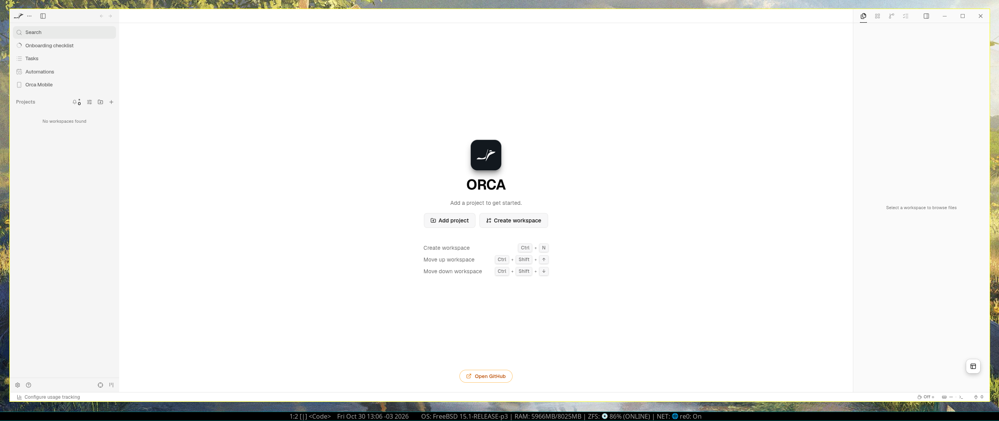

# Orca ADE — FreeBSD Port

> Native FreeBSD port of [Orca ADE (Agent Development Environment)](https://github.com/stablyai/orca) designed for parallel AI coding agents.



---

## 📌 Sobre o Projeto / About

**Orca** é um ambiente de desenvolvimento de última geração (ADE - *Agent Development Environment*) focado em orquestrar e gerenciar frotas de agentes autônomos de IA para codificação (Claude Code, Grok, Codex, etc.) simultaneamente em **Git worktrees isolados**.

Este repositório contém o **FreeBSD Port oficial (`editors/orca-ade`)** e os binários empacotados prontos para uso no **FreeBSD 15.1+ (amd64)**.

* **Repositório Original:** [stablyai/orca](https://github.com/stablyai/orca) (Release `v1.4.244`)
* **Autor Original:** [Lovecast Inc.](https://github.com/stablyai)
* **Mantenedor do Port FreeBSD:** Christian Batista (`christian@FreeBSD.org`)

---

## ⚠️ Desambiguação de Nome (`orca` vs `orca-ade`)

No ecossistema FreeBSD, o port `accessibility/orca` (o leitor de tela oficial do ambiente GNOME) já instala o binário `/usr/local/bin/orca`.

Para evitar qualquer conflito de empacotamento ou colisão no `$PATH`, este port foi nomeado como **`orca-ade`**:
* **Port Category/Name:** `editors/orca-ade`
* **Package Name:** `orca-ade-1.4.244.pkg`
* **Executável:** `/usr/local/bin/orca-ade`
* **Desktop Entry:** `/usr/local/share/applications/orca-ade.desktop`
* **Ícone:** `/usr/local/share/pixmaps/orca-ade.png`
* **Diretório de Dados:** `/usr/local/share/orca-ade/`

---

## 🔧 O que foi adaptado para o FreeBSD

1. **Target Runtime — Electron 42:**
   * Utiliza o pacote oficial do FreeBSD `devel/electron42` (`42.11.10`).
   * Headers do Node embutidos em `/usr/local/share/electron42/node_headers` usados para recompilação de bindings nativos.

2. **Módulos Nativos C++ Recompilados:**
   * **`node-pty`:** Compilado via `node-gyp` para arquitetura FreeBSD amd64, garantindo suporte completo a pseudo-terminais POSIX para os terminais embutidos dos agentes de IA.
   * **`@parcel/watcher`:** Compilado ativando o backend nativo **`kqueue`** do kernel FreeBSD (`KqueueBackend.cc`) para monitoramento ultra-rápido de alterações de arquivos sem polling.

3. **Helper Nativo C (`orca-wayland-clipboard`):**
   * O utilitário nativo de sincronização de clipboard Wayland/X11 foi compilado com o Clang nativo do FreeBSD (`cc -O2 -fPIE -pie`) e linkado com `graphics/wayland` (`libwayland-client.so`).

4. **Transpilação Offline & Empacotamento ASAR:**
   * Bundle transpilado via Vite/Rolldown de forma estritamente offline (`build-source-commit` pinned).
   * Gerador `prepare-asar-dir.mjs` que consolida estritamente as dependências de produção de runtime, empacotando com `@electron/asar` e extraindo os módulos nativos para `app.asar.unpacked/`.

---

## 🚀 Instalação Rápida (Pacote Pré-compilado)

Se você já usa FreeBSD 15+ (amd64) com interface gráfica (X11 ou Wayland), pode instalar diretamente o pacote `.pkg` fornecido no repositório:

### 1. Instalar dependências de sistema
```bash
doas pkg install -y electron42 git wayland desktop-file-utils
```

### 2. Instalar o pacote do Orca ADE
```bash
doas pkg install -y packages/orca-ade-1.4.244.pkg
```

### 3. Executar
```bash
orca-ade
```
*(Ou abra pelo menu do seu ambiente gráfico: **Development -> Orca ADE**)*

---

## 🛠️ Compilação via FreeBSD Ports

Para compilar do código-fonte utilizando a infraestrutura padrão do FreeBSD Ports:

```bash
# 1. Copiar o port para a árvore de ports local
doas mkdir -p /usr/ports/editors/orca-ade
doas cp -R * /usr/ports/editors/orca-ade/

# 2. Entrar no diretório do port
cd /usr/ports/editors/orca-ade

# 3. Compilar e empacotar
make stage
make check-plist
make package

# 4. Instalar o pacote gerado
doas make install clean
```

---

## 📂 Estrutura do Repositório

```text
.
├── Makefile                     # Makefile padrão do FreeBSD Ports
├── distinfo                     # Hashes SHA256 e tamanhos dos distfiles
├── pkg-descr                    # Descrição oficial do port
├── pkg-plist                    # Packing list estrito verificado pelo check-plist
├── files/
│   ├── orca-ade.in              # Wrapper script de inicialização do Electron
│   ├── orca-ade.desktop.in      # Entrada para o menu XDG Desktop
│   └── prepare-asar-dir.mjs     # Script de isolamento das dependências de runtime
├── packages/
│   └── orca-ade-1.4.244.pkg     # Pacote binário oficial pronto para instalação
├── screenshots/
│   └── orca-ade-freebsd-x11.png # Screenshot do Orca ADE aberto no FreeBSD X11
├── LICENSE                      # Licença MIT
└── README.md                    # Esta documentação
```

---

## 📄 Licença / License

* O software original **Orca** é licenciado sob a licença **MIT** pela **Lovecast Inc.**
* Os scripts de adaptação, empacotamento e arquivos do FreeBSD Port também são distribuídos sob a licença **MIT**.
* Veja o arquivo [LICENSE](LICENSE) para detalhes completos.
